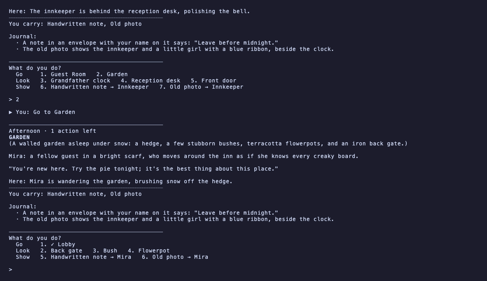
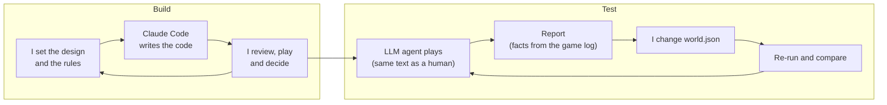

# The Last Day Inn

A tiny text mystery set in a time loop, built to test one question: **after the first reset, do players want to try again?**

- **The game:** 3 rooms, 2 characters, 5 clues, 8 actions a day. The innkeeper wished today would never end, and the clock made it so.
- **My role:** solo, over two days. I wrote the story and chose its key lines (the note, the photo, Mira's pie lines); Claude drafted the rest of the dialogue, marked as drafts in `world.json`, and wrote the engine.
- **What AI playtests can show:** whether the mystery is understandable, and whether players investigate differently after the reset. Whether it's compelling enough to try again still needs human players.
- **Key finding:** every AI playtester worked out the time loop after the first reset (9 of 9), but only 5 of 9 reached the reveal. Recent runs that missed never showed Mira the photo: the problem is discoverability, not timing.
- **Why AI is next:** 105 reachable situations share 11 written reactions; see [Next phase](#next-phase-where-ai-becomes-the-material).
- **Focus:** systems and narrative design, agentic playtesting, UX for low cognitive load, Python prototyping.

## What it looks like



Gameplay, trimmed to the reveal (18s). At the reveal, the player should think "Wait… I think I figured out how this world works", not "This AI is clever."

## The design

Evidence should open new questions, not hand out answers. The player, not the AI, solves the mystery; when AI joins the game, it will work under the truth I set.

Cognitive load stays low. There's no free text, so solving never turns into prompting. One menu groups actions as Go, Look and Show, and a ✓ marks what you've done today.

Every story line and rule lives in `world.json`, so I own the truth. The full design is in [docs/design-doc.md](docs/design-doc.md), and the build log is in [DEVLOG.md](DEVLOG.md).

## Agentic workflow

The build loop is an agentic production workflow, and the test loop is an AI playtest; I make the decisions in both.



- The playtest agent is Gemini 3.1 Flash-Lite, with a curious and an escape persona, each with the journal on and off.
- It gets the same text as a player through one `observe()` / `actions()` / `act()` interface; only its menu isn't grouped. It never sees `world.json`, the design doc, CLAUDE.md or the DEVLOG.
- 40 unit tests and a `--dry-run` (fake model, 0 API calls) check changes.
- API use so far: 446 recorded model calls (retries not counted) and about 1.2 M input and 16 K output tokens (estimated). No Claude calls.

## What changed after testing

| # | Problem found | Change | Result | Runs (before / after) | Commits |
|---|---|---|---|---|---|
| 1 | Players kept trying the clock's "little door" | "The little door won't open." | Repeat looks in one day 2 → 1 | 1 / 1 | [before](https://github.com/verenakcn/last-day-inn/commit/c41857d) · [after](https://github.com/verenakcn/last-day-inn/commit/6a654af) |
| 2 | Still a dead end | A child's scratched star on it | **Backfired:** clock-door notes 4 → 9 | 1 / 1 | [before](https://github.com/verenakcn/last-day-inn/commit/9a0014c) · [after](https://github.com/verenakcn/last-day-inn/commit/4ab5681) |
| 3 | Still pulled attention | Door removed | Clock-door notes 2 → 0 (curious), 4 → 0 (escape) | 2 / 2 | [before](https://github.com/verenakcn/last-day-inn/commit/f937d34) · [after](https://github.com/verenakcn/last-day-inn/commit/e1bc6d1) |
| 4 | *My playtest:* abrupt midnight, dense screen | Midnight warning and fade; one screen order | Late-trigger misses 2 → 0 | 4 / 4 | [dc9ad13](https://github.com/verenakcn/last-day-inn/commit/dc9ad13) |

*Clock-door notes are agent notes that mention the clock's door or star, not the front door. In rows 1–2 the agent was still partly told about loops.*

## How I tested

A run is one finished game by the AI agent, saved as a report: 19 in all, plus 5 that stopped on API errors and aren't counted. A round is 4 runs (both personas, journal on and off). Headline numbers use 9 runs: [round 1](reports/20261102-010947-aggregate.md), [round 2](reports/20261102-222613-aggregate.md) and one extra run (see Limits). The ribbon count uses all 19.

## What I learned

1. The loop is inferable, and the reset changes how players investigate. All 9 runs named a time loop after the first reset, including round 1, whose reset prompt had no loop wording ([94193bb](https://github.com/verenakcn/last-day-inn/commit/94193bb)). In the 13 runs with no loop hint, 61% of day-2 actions were new, and all 13 tested an idea from day 1. (My reading of its notes. The agent has no quit option, so playing on isn't proof it wants to.)
2. Since fix 4, discoverability is the bottleneck, not timing. 5 of 9 runs reached the reveal: 2 of 4 in each round, plus the extra run. Before fix 4, both runs that missed showed Mira the photo on day 3, too late. After it, neither showed her the photo. The journal isn't required: one run in each round reached the reveal with it off.
3. Point clues at a person or a question, not at an object that looks interactive. In fix 2, a clue on the door raised clock-door notes from 4 to 9.
4. Keep the agent's view identical to a player's, and take facts from the log. The first 6 finished runs were hinted, including those for fixes 1–2. They saw a "Loop" number on screen, and each reset said "A new loop seems to have started". Reports count facts from the game log; the agent's notes only show what it understood.
5. Being available isn't the same as being noticed. No run examined the bush with the blue ribbon (0 of 19), though "Examine Bush" was on the menu in most runs.
6. AI playtests show what players do and conclude, not how it feels. All 9 final theories read grief, ghosts, purgatory, loss or regret into the story, though no game line uses those words. An early hint of the story's melancholy, or the model's habit? Only human players can tell.

## Limits and next steps

Limits of the evidence:
- Small samples: 1–2 runs per condition on the new screen layout.
- A third round was cut short: 1 run finished (the extra run above), and 4 stopped on API errors.
- One model: all 24 live runs, finished or not, used Gemini 3.1 Flash-Lite.
- Personas shape results: the curious persona is told to "show evidence to everyone", which is what triggers the reveal.
- AI players, plus one human who knows the story. The agent also knows time-loop stories.

Next steps:
1. Fix discoverability: a character nudges players to show Mira the photo.
2. Human playtests with fresh players, on the core question and the reveal.
3. More runs, and a Claude comparison (`--provider claude`, paid).

## Next phase: where AI becomes the material

Characters should react sensibly to any clue, situation and history. Hand-writing can't keep up, even here:

- 5 clues × 2 characters × 4 time slots × 3 days = 120 combinations.
- 105 are reachable, because a character must be in the room and the innkeeper is away at night: 5 clues × 7 character-time slots a day × 3 days.
- All 105 share 11 written reactions and 2 fallback lines. Only one reaction changes with the day, and none changes with what the player did before.
- Count what the player showed a character on earlier days, and every new day adds more cases. Written reactions have to grow with every case; a model working from the same rules doesn't.

The plan: `world.json` stays the truth, and the playtest agent flags invented facts. The test is rule-based vs AI: are reactions sensible and useful, and do players test more theories?

Two steps, both with Mira:
1. **She reacts.** When you show her something, an LLM writes her reply from what she knows. She can hint but never explain. The engine replaces any line that breaks her rules with a written one.
2. **She remembers.** If she was by the clock at midnight, the next morning she still says her pie line, then adds a fragment of what you showed her the day before. The same situation always gets the same line, so repeated lines still give the loop away.

## Run it

Python 3.9+. Playing and testing need no packages.

```bash
git clone https://github.com/verenakcn/last-day-inn.git && cd last-day-inn
python3 play.py                 # play in the terminal (add --no-journal for journal off)
python3 serve.py                # play in a browser at http://localhost:8000
python3 -m unittest             # 49 tests, no API calls
python3 agent.py --dry-run      # AI playtester with a fake model, 0 API calls
```

Live playtests need a free Gemini API key in a git-ignored `.env` file: one line, `GEMINI_API_KEY=your-key`. Then:

```bash
pip install google-genai
python3 agent.py --persona escape --no-journal   # one live run (about 3–6 min)
python3 agent.py --all          # 4 live runs + aggregate report
python3 agent.py --interview reports/<run>.json questions.txt   # questions.txt: one per line
```

All agent options are at the top of [agent.py](agent.py); every game logs to `logs/`. To re-record the GIF, run `brew install vhs`, then `vhs docs/reveal.tape`.
