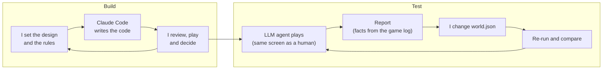

# The Last Day Inn

A tiny text mystery set in a time loop, built to test one question: **after the first reset, do players want to try again?**

- **The game:** 3 rooms, 2 characters, 5 clues, 8 actions a day. The innkeeper wished today would never end, and the clock made it so.
- **My role:** solo, over two days. I designed the game and the playtest method and made every call; Claude Code wrote the engine and first-draft text, which I reviewed.
- **Key finding:** every AI playtester worked out the time loop after the first reset (9 of 9), but only 5 of 9 reached the reveal: its trigger is too easy to miss.
- **Focus:** systems and narrative design · agentic playtesting · UX for low cognitive load · Python prototyping

## What it looks like


*A real `play.py` session (33 s). Re-record: `vhs docs/reveal.tape`.*

## The design

- **Pillars:** evidence creates questions, not answers · the player, not the AI, solves the mystery; when AI joins the game, it works under the truth I set.
- **Low cognitive load:** no free text (solving shouldn't become prompting) · a menu grouped as Go / Look / Show · ✓ on actions already taken.
- **I own the truth:** every line and rule lives in `world.json`; the engine holds no story.
- Full design: [docs/design-doc.md](docs/design-doc.md) · build log: [DEVLOG.md](DEVLOG.md)

## Agentic workflow

Two AI agents, two loops, one decision-maker: me.



- **Playtest agent:** Gemini 3.1 Flash-Lite (or Claude); curious and escape personas × journal on / off.
- **Same view as a player:** one `observe()` / `actions()` / `act()` interface.
- **Automated QA:** 40 unit tests and a `--dry-run` (fake model, 0 API calls) check every change.

What the agent writes, from [a real report](reports/20261102-221104-curious-journal-on.md):

> **After waking again:** "The inn is caught in a temporal loop triggered by the grandfather clock at midnight…"
>
> **Next day, why it shows Mira the photo:** "…since the note felt familiar to her, perhaps the photo will trigger a stronger realization."

## What changed after testing

| # | Problem found | Change | Result | Commits |
|---|---|---|---|---|
| 1 | Players kept trying the clock's "little door" | "The little door won't open." | Repeat looks in one day 2 → 1 | [before](https://github.com/verenakcn/last-day-inn/commit/c41857d) · [after](https://github.com/verenakcn/last-day-inn/commit/6a654af) |
| 2 | Still a dead end | A child's scratched star on it | **Backfired:** door/star notes 8 → 11 | [before](https://github.com/verenakcn/last-day-inn/commit/9a0014c) · [after](https://github.com/verenakcn/last-day-inn/commit/4ab5681) |
| 3 | Still pulled attention | Door removed | Door notes 6 → 1 (curious), 5 → 0 (escape) | [before](https://github.com/verenakcn/last-day-inn/commit/f937d34) · [after](https://github.com/verenakcn/last-day-inn/commit/e1bc6d1) |
| 4 | *My playtest:* abrupt midnight, dense screen | Midnight warning and fade; one screen order | Late-trigger misses 2 → 0 (one run each) | [dc9ad13](https://github.com/verenakcn/last-day-inn/commit/dc9ad13) |

## Findings

Each round is both personas × journal on / off: [round 1](reports/20261102-010947-aggregate.md) · [round 2](reports/20261102-222613-aggregate.md) · round 3 ([1 run so far](reports/20261102-232119-curious-journal-on.md); API outages stopped the rest).

- **The loop is inferable:** all 9 named it after the first reset, including round 1, which had no hint at all ([94193bb](https://github.com/verenakcn/last-day-inn/commit/94193bb)).
- **Reveal timing is the bottleneck:** 2 of 4 reveals in rounds 1 and 2 (round 3: 1 of 1); misses came from a last-day trigger or a photo that never reached Mira.
- **Why:** nothing points the photo at Mira, and escape-minded players may skip the drawer.
- **One clue is invisible:** the blue ribbon, 0 of 19 live runs (I found it when I played).
- **Tone drifts dark:** 9 of 9 final theories read grief, ghosts or "purgatory" into a cozy story.
- **The journal isn't required:** reveals happened with it off, in rounds 1 and 2.

## What I learned

**Design**
- **Setup before payoff:** "You *still* haven't tried the pie" only works after "Try the pie tonight" ([8ea08f7](https://github.com/verenakcn/last-day-inn/commit/8ea08f7)).
- **Point clues at a person or a question,** not at an object that looks interactive (a scratched star: door notes 8 → 11).
- **Hide the rule:** a "Loop 1" counter gave the mystery away; without it, AI players still worked it out.
- **Key clues can't depend on optional UI:** with the journal off, the photo's content never appeared.

**Playtesting with AI**

The agent speeds up iteration but doesn't replace judgement: it plays a full game in minutes and surfaces signals (missed clues, wasted moves, its theories). Deciding what those signals mean, and how the game *feels*, took my judgement and still needs human players.

- **Keep the agent's view identical to a player's:** an early prompt hinted at loops and inflated results.
- **Facts from the game log, meaning from the AI:** the log records what happened; the agent's notes show what it understood.
- **Read the agent's notes, not just the numbers:** one wrote "Everyone has suddenly vanished", a glitch I fixed later.
- **Proof from this project:** the agent found the clock-door problem in one run, but it took my judgement to see why the star backfired; and only my own play caught the abrupt midnight.

## Limits and next steps

**Limits of the evidence**
- **Small samples:** 1–2 runs per condition on the current version.
- **One model:** all live runs used Gemini 3.1 Flash-Lite.
- **AI players, plus one human who knows the story:** the agent can't say whether it *wants* to play again (the core question), and it knows time-loop stories.

**Next steps**
1. **Fix the reveal timing:** a character nudges players toward showing Mira the photo.
2. **Human playtests:** fresh players, on the core question and the reveal.
3. **More runs and a second model:** repeat rounds, and a Claude comparison (one flag away).

## Next phase: where AI becomes the material

- **Mechanic:** characters react sensibly to *any* clue, situation and history, even combinations nobody wrote.
- **Guard:** `world.json` stays the truth; the playtest agent flags invented facts.
- **Test:** rule-based vs AI: are reactions sensible and useful, and do players test more theories?
- **First step:** Mira reacts through an LLM under these rules.

## Run it

```bash
python3 play.py                 # play (add --no-journal for journal off)
python3 -m unittest             # 40 tests, no API calls
python3 agent.py --dry-run      # AI playtester with a fake model, 0 API calls
python3 agent.py --all          # 4 live runs + aggregate (needs GEMINI_API_KEY in .env, ~25 min)
```
